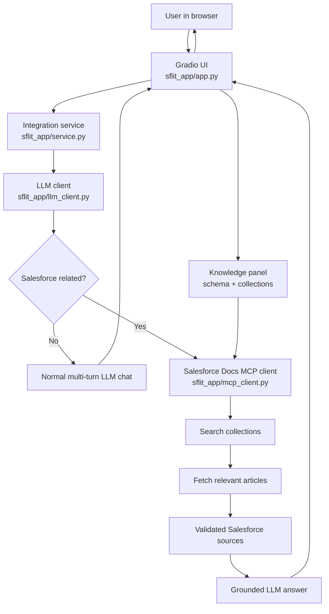

# Salesforce LIT End-to-End Program Flow

## 1. System Purpose

Salesforce LIT is a Python-native Gradio helpful assistant. It supports ordinary multi-turn conversation, while Salesforce-related questions follow a grounded documentation path through the Salesforce Docs MCP tools.

The central rule is:

```text
LLM classifies the turn
  GENERAL      -> normal LLM conversation
  SALESFORCE   -> Salesforce Docs MCP search -> evidence validation -> grounded LLM answer
```

The assistant does not use model memory as the source of truth for Salesforce claims.

## 2. Component Map



| Component | File | Responsibility |
| --- | --- | --- |
| Launcher | `run_sflit.py` | Imports the app and starts Gradio. |
| Gradio application | `sflit_app/app.py` | Collects the question, history, audience, release, and optional collection; displays Knowledge metadata, answers, and source links. |
| Integration service | `sflit_app/service.py` | Routes each turn, preserves history, invokes MCP only for Salesforce turns, validates evidence, and applies fallback policy. |
| LLM client | `sflit_app/llm_client.py` | Classifies intent, answers general turns, and summarizes validated Salesforce evidence using the OpenAI Python client. |
| MCP client | `sflit_app/mcp_client.py` | Calls MCP schema/resource operations plus search and fetch over JSON-RPC. |
| Tests | `tests/test_service.py` | Verifies routing, grounding, no-source refusal, fallback behavior, and general chat. |

## 3. Startup Flow

1. `run_sflit.py` imports the Gradio app.
2. `sflit_app.app` creates `SalesforceLitService()`.
3. The service creates `SalesforceDocsClient()` and `OpenAICompatibleFormatter()` by default.
4. The formatter uses `LLM_BASE_URL` or `http://localhost:11434/v1`, `LLM_MODEL` or the configured local model, and `LLM_API_KEY`, `OPENAI_API_KEY`, or the Ollama placeholder key `ollama`. Generation defaults to a 120-second timeout and 512 output tokens.
5. Gradio builds the audience, release, conversation, and source controls.
6. `run_sflit.py` launches the local server.

Start the local model with:

```powershell
ollama pull llama-3.2
ollama serve
python run_sflit.py
```

For faster local responses, use the installed smaller model:

```powershell
$env:LLM_MODEL = "llama3.2:latest"
```

## 4. UI to Integration Layer

The Gradio handler sends four values to `SalesforceLitService.answer`:

- `question`: the latest user message.
- `history`: the current browser-session messages in Gradio message format.
- `mode`: `Learner` or `Developer`.
- `release`: the selected Salesforce release.
- `collection`: the optional Knowledge collection selected for search.

The handler does not decide whether a question is about Salesforce. It appends the returned answer to the displayed history and renders returned sources as Markdown links.

## 5. Integration Routing Flow

`SalesforceLitService.answer` performs these steps:

1. Strip the latest question. An empty question returns `How can I help?` without network calls.
2. For Knowledge questions, load live MCP schema and collection metadata and answer from that context.
3. Send other questions and recent history to `is_salesforce_question` on the LLM client.
4. For `GENERAL`, call `answer_general` with the same recent history. MCP is not called and the result has no sources.
5. For `SALESFORCE`, call `SalesforceDocsClient.search` with the question, release, and optional selected collection.
6. Convert the first four returned chunks to `Source` records and discard records without document IDs.
7. Fetch each selected document with `SalesforceDocsClient.fetch`; only fetched article content is accepted as answer evidence.
8. If no fetched sources remain, return a refusal instead of asking the LLM to invent an answer.
9. Build bounded evidence from fetched article content and source metadata.
10. Ask the LLM to read and summarize only that evidence in simple Markdown bullets.
11. If presentation fails, return grounded local bullets made directly from the fetched article excerpts.

The service passes up to the latest ten history messages to the LLM. The current question is appended as the final user message for both classification and general chat.

## 6. LLM Client Layer

`OpenAICompatibleFormatter` uses the OpenAI Python client, which also works with Ollama's OpenAI-compatible API.

### Intent classification

The classifier must return `SALESFORCE` for questions about Salesforce, Salesforce products, Apex, Lightning, SOQL, objects, APIs, metadata, releases, or Salesforce documentation. It must return `GENERAL` for unrelated conversation. Recent messages are included so a follow-up such as `What about the previous feature?` can remain in the Salesforce route.

### General chat

General turns use a conversational system prompt and recent history. They do not receive Salesforce evidence and do not call MCP.

### Grounded Salesforce presentation

Salesforce turns use a separate prompt that limits the answer to supplied MCP evidence, asks for three to six concise bullets, and disallows invented citations or details.

### LLM failure fallback

If classification fails, the service checks a conservative list of Salesforce terms. A matching question still goes to MCP. If answer presentation fails, source excerpts are rendered as local bullets. A general turn that cannot reach the LLM returns a readable service-unavailable message.

## 7. Salesforce Docs MCP Layer

`SalesforceDocsClient.search` prefixes a selected release to the query and calls `salesforce_docs_search` with semantic search. The remote result contains document chunks. The client normalizes JSON-RPC, transport, timeout, and MCP errors into `McpClientError`.

The service requests six chunks from MCP but exposes at most four sources. Each excerpt is whitespace-normalized and capped at 900 characters before it is given to the LLM.

The service uses `search` to understand the available result collection and `fetch(document_id)` to retrieve the relevant article before formatting an answer. Search snippets are never used as the final grounded evidence.

## 8. Grounding and Safety Rules

- General conversation may be answered normally by the LLM.
- Any Salesforce-related answer must pass through Salesforce Docs MCP.
- A Salesforce answer requires at least one returned chunk with a document ID.
- Empty or unusable MCP results produce a no-speculation refusal.
- Sources are returned separately so the UI can show links beside the answer.
- Release and audience values affect Salesforce presentation and retrieval context; they do not bypass grounding.

## 9. Browser Conversation State

History exists for the active browser session only. The UI retains it visually and passes it back into the service on every turn. The service forwards recent turns to the LLM but does not persist them to disk or a database. Clearing the conversation resets the Gradio history and sources panel.

## 10. Tests

`tests/test_service.py` patches client construction with fake clients and formatters, so it does not require network access. The tests cover:

- Salesforce routing and source preservation.
- Passing grounded evidence to the LLM formatter.
- Local bullet fallback when formatting is unavailable.
- Refusal when MCP returns no usable evidence.
- General multi-turn chat bypassing MCP and receiving history.

Network behavior, real Ollama responses, and Gradio event wiring remain integration-test concerns.
